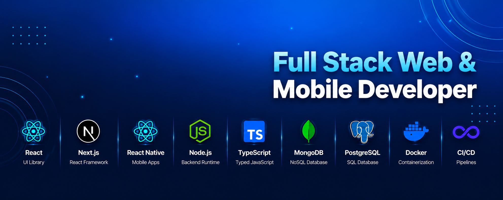

<h2 align="center"> I am open to work remotely .</h2>

 

**Full-Stack Developer | React, Next.js, Node.js & React Native | Building web and mobile experiences.**

- All of my projects are available at https://nazneenlipi.vercel.app

- Ask me about **Website build, Custom website, E-commerce website, Full stack website**

- How to reach me **lipinazneen65@gmail.com**
 
- Know about my experiences . Here is my  <a href="https://docs.google.com/document/d/1fXjUn6bUk0pRmJBsp4F4hX0GQRWmrANcXgaAH4S0irs/edit?usp=sharing" target="_blank">resume</a>

<h3 align="left">Connect with me:</h3>

  <a href="https://medium.com/@th.guibert" target="_blank">
</a>

## 🛠️ Tech Stack & Tools

- **Languages:** TypeScript, JavaScript
- **Backend:** Node.js, Express.js, REST APIs, GraphQL
- **Database & ORM:** MongoDB, Mongoose, Prisma
- **Authentication & AI:** Authentication Flows, Two-Factor Authentication (2FA)
- **Frontend & Mobile:** React, Next.js, React Native, Expo, Tailwind CSS, Styled Components, Astro.js
- **Tools & Workflow:** Git, Turborepo, Figma, CI/CD

---

## 💼 Experience

- **XIIA** — Software Engineer *(June 2025 – November 2026)*
- **Longbitz** — Frontend Developer *(Internship)*
- **Pii Marketer** — Frontend Developer *(Internship)*

---

## 🚀 Products & Platforms

- **Soundmade** — A mobile music platform connecting artists and fans on iOS and Android.
- **[WeWaive](https://wewaive.com/)** — A mobile platform for royalty-free AI music with a trial-based subscription experience.
- **[Kiibee](https://www.kiibee.com/)** — A content-commerce platform for publishing and selling digital content.
- **[Foodime](https://foodime.dk/)** — A restaurant POS platform with mobile apps, admin dashboards, and manager workflows.

### Technologies, Frameworks, Languages & Tools

<h2 align="center">⚡ Stats ⚡</h2>
 
  

   
  

 
 

           

<h2 align="center" >👨‍💻 Repositories 👨‍💻</h2>
 

      

 

      

<h4 align="center">
  <a href="https://github.com/nazneenlipi?tab=repositories" title="Show Repositories">🔎 Show More 🔍</a>
</h4>

  

<h2>Support Me </h2>  

